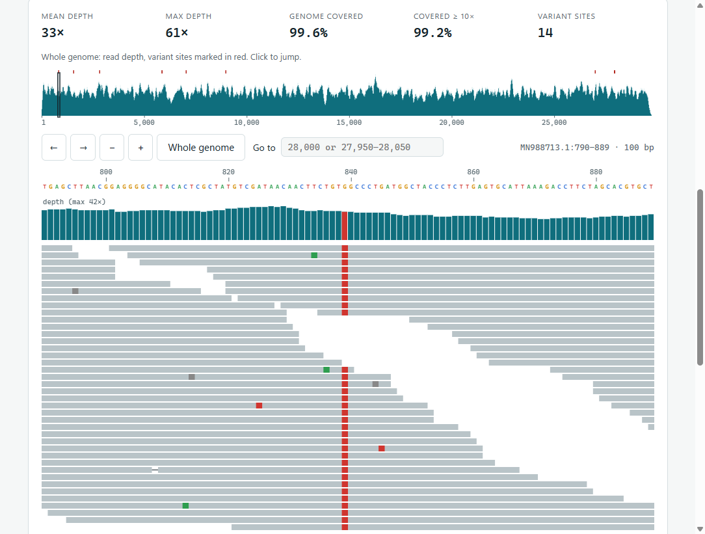
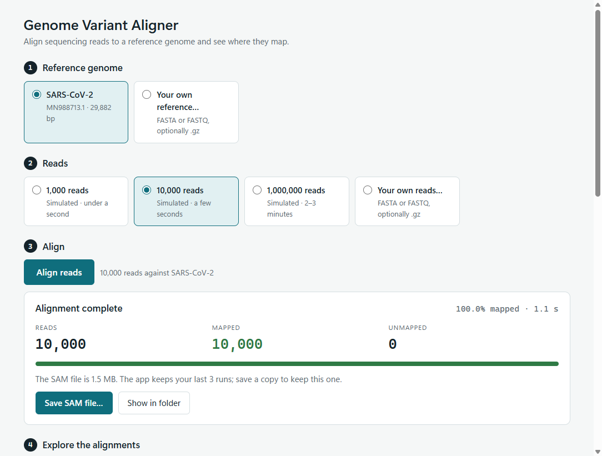
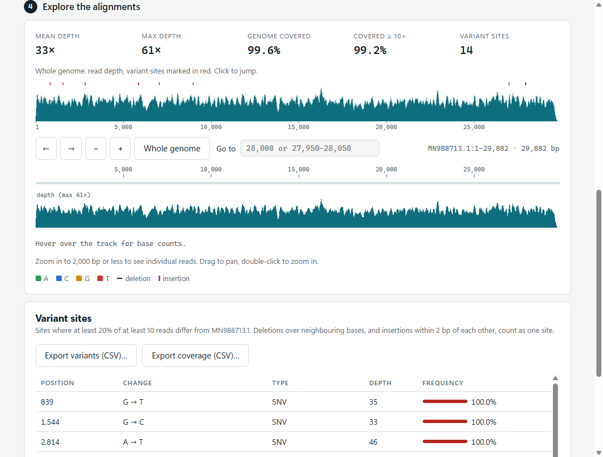

<div align="center">


# coronavirus-genome-variant

[](https://github.com/RyanDBurke/coronavirus-genome-variant/actions/workflows/ci.yml)
[](LICENSE)

A seed-search alignment tool that compares sequencing reads to the SARS-CoV-2 (nCov-19) genome using the Burrows-Wheeler transform, suffix arrays, the FM-Index and dynamic programming, with a Windows desktop app to run it and explore the results.

</div>

<p align="center">
  
</p>

## Contents

- [Download the app](#download-the-app)
- [Using the app](#using-the-app)
- [How it works](#how-it-works)
- [For developers](#for-developers)
  - [Quick start (command line)](#quick-start-command-line)
  - [Requirements](#requirements)
  - [Setup](#setup)
  - [Running](#running)
  - [Testing](#testing)
  - [Desktop app from source](#desktop-app-from-source)
  - [Viewing results in IGV](#viewing-results-in-igv)
  - [Troubleshooting](#troubleshooting)
  - [Project layout](#project-layout)
- [References](#references)
- [Future goals](#future-goals)
- [License](#license)

## Download the app

For Windows 10 and 11 (x64). The app includes the SARS-CoV-2 reference genome and three example read sets, works fully offline, and installs for your user without administrator access.

1. Open the [Releases page](https://github.com/RyanDBurke/coronavirus-genome-variant/releases) and, under the newest release, download `GenomeVariantAligner-Setup-<version>.exe`.
2. The installer isn't code-signed yet, so Windows is cautious about it:
   - If Edge says the file **isn't commonly downloaded**, open the downloads list (**Ctrl+J**), choose **⋯ → Keep**, then **Show more → Keep anyway**.
   - When you run it, if SmartScreen shows **Windows protected your PC**, choose **More info → Run anyway**.
3. The installer finishes on its own and opens the app. It's then in the Start menu as **Genome Variant Aligner**.

**Optional: check the download.** Download `SHA256SUMS.txt` from the same release, then in PowerShell, in your Downloads folder:

```powershell
Get-FileHash -Algorithm SHA256 .\GenomeVariantAligner-Setup-<version>.exe
Get-Content .\SHA256SUMS.txt
```

The two hashes for the installer must match (`Get-FileHash` prints capitals, the file lowercase; that's fine). The same works for the standalone command-line `run.exe` in each release.

**Uninstalling** (Settings → Apps → Installed apps) removes the app's saved runs and settings. Files you saved or exported elsewhere stay. Security details and release checks are in [app/SECURITY.md](app/SECURITY.md).

## Using the app

1. **Choose a reference genome.** SARS-CoV-2 is built in, or open your own FASTA file.
2. **Choose reads.** Three simulated read sets are built in (1,000, 10,000 and 1,000,000 reads), or open your own FASTA/FASTQ file (`.gz` works too).
3. **Press Align reads.** You get read counts and a SAM file you can save. Runs can be cancelled; the app keeps your last three.

<p align="center">
  
</p>

After a run, the app shows the results directly, with no samtools or IGV needed:

- **Whole-genome depth** with variant sites marked; click anywhere to jump there.
- **A zoomable track** with the reference bases, read depth (coloured where reads disagree with the reference) and, below 2,000 bp, the reads themselves with mismatches, deletions and insertions marked. Drag to pan, double-click to zoom, hover for per-base counts, or type a position or range.
- **Variant sites**: positions where at least 20% of at least 10 reads differ from the reference (SNVs, deletions, insertions), with depth and frequency. Neighbouring deleted bases, and insertions within 2 bp of each other, count as one site. Click one to jump to it.
- **Exports**: variants and per-base coverage (depth and A/C/G/T/deleted/inserted counts) as CSV.

This works for the 1,000,000-read set too: the app makes one pass over the SAM file (about 4 seconds) to build depth, allele counts and a position index, then reads only the reads in view straight from the file.

<p align="center">
  
</p>

## How it works

1. **Index the genome.** Build the suffix array of the genome (plus a `$` end marker), derive the Burrows-Wheeler transform from it, and add rank tables (occurrence counts checkpointed every 64 rows). Together these form the FM-Index (`src/fmIndex.c`).
2. **Seed.** Split each read into five equal seeds (20 bp for 100 bp reads) and find every exact occurrence of each seed with FM-Index backward search. A seed containing a variant simply finds nothing; the other seeds still place the read.
3. **Extend.** For each candidate position, cut the reference with 5 bp of padding on both sides and run a fitting alignment, a dynamic-programming alignment where the whole read must align but reference bases outside it are free (`src/align.c`). The traceback gives the start position and CIGAR string.
4. **Report.** Keep the best-scoring alignments across all seeds and write SAM: one primary record per read, equally good alternatives as secondary, and unmapped reads flagged.
5. **Visualize.** The desktop app shows depth, reads and variant sites directly. From the command line, load the SAM into Integrative Genomics Viewer (IGV) to see coverage.

## For developers

Everything below is for building the aligner or the app yourself, using the command line, or calling the aligner from other programs. The command-line aligner works on Linux, on Windows natively, and on Windows through WSL.

### Quick start (command line)

On Debian/Ubuntu (or inside WSL):

```bash
git clone https://github.com/RyanDBurke/coronavirus-genome-variant.git
cd coronavirus-genome-variant
./dep.sh       # install dependencies
make           # build ./run
./run          # small demo run
```

On Windows, see [Setup → Option B: Windows native](#option-b-windows-native-msys2) or [Option C: Windows with WSL](#option-c-windows-with-wsl).

### Requirements

- **Debian or Ubuntu:** `dep.sh` installs everything needed:
  - `gcc` and `make`: to build
  - `zlib1g-dev`: to read the gzipped read files
  - `samtools`: only needed to prepare results for IGV
- **Windows:** either [MSYS2](https://www.msys2.org/) to build a native `run.exe`, or [WSL](https://learn.microsoft.com/windows/wsl/install) to use the Linux build.

### Setup

#### 1. Clone

```bash
git clone https://github.com/RyanDBurke/coronavirus-genome-variant.git
cd coronavirus-genome-variant
```

#### 2. Install dependencies and build

Pick the option for your system:

- [Option A: Debian or Ubuntu](#option-a-debian-or-ubuntu)
- [Option B: Windows native (MSYS2)](#option-b-windows-native-msys2): builds `run.exe`, which then runs from PowerShell with nothing else installed
- [Option C: Windows with WSL](#option-c-windows-with-wsl)

##### Option A: Debian or Ubuntu

```bash
./dep.sh       # install dependencies (uses sudo apt-get, so it asks for your password)
make           # build ./run
```

##### Option B: Windows native (MSYS2)

Install MSYS2 from PowerShell:

```powershell
winget install MSYS2.MSYS2
```

Then open **MSYS2 UCRT64** from the Start menu, `cd` to the repo (for example `cd /c/Users/you/coronavirus-genome-variant`), and run:

```bash
pacman -S --needed make mingw-w64-ucrt-x86_64-gcc mingw-w64-ucrt-x86_64-zlib mingw-w64-ucrt-x86_64-python
make           # build run.exe
```

`run.exe` is self-contained: it uses only libraries built into Windows 10 and 11, so you can copy it anywhere. Every CI run also publishes it as the `run-windows-x64` artifact on the [Actions page](https://github.com/RyanDBurke/coronavirus-genome-variant/actions/workflows/ci.yml).

##### Option C: Windows with WSL

Everything runs inside WSL. From the repo folder in PowerShell:

```powershell
wsl --install            # one-time; restart if prompted
.\dep.ps1                # install dependencies inside WSL (asks for your Ubuntu sudo password)
wsl make                 # build ./run
```

### Running

Run **one** of these:

| Debian / Ubuntu | Windows PowerShell | Input reads | Notes |
|---|---|---|---|
| `./run` | `.\run.exe` | `default/reads-small.fa` | Small demo against `default/ref-small.fa`. Also writes the FM-Index to `fm-output/FMindex.txt`. |
| `./run covid 1K` | `.\run.exe covid 1K` | `reads/reads_1K.fa.gz` | 1,000 reads against `2019-nCoV.fa` |
| `./run covid 10K` | `.\run.exe covid 10K` | `reads/reads_10K.fa.gz` | 10,000 reads |
| `./run covid 1M` | `.\run.exe covid 1M` | `reads/reads_1M.fa.gz` | 1,000,000 reads. Takes about 2½ minutes. |
| `./run -r REF.fa -q READS.fa -o OUT.sam` | `.\run.exe -r REF.fa -q READS.fa -o OUT.sam` | any FASTA file (`.gz` works too) | Your own reference and reads. |

The Windows column is for the native build (Option B). With WSL (Option C), use the Debian / Ubuntu commands with a `wsl` prefix, for example `wsl ./run covid 1K`.

Without `-o`, alignments go to `mappings/mapping.sam`, overwriting the previous result. The FM-Index file is only written for references of 50 bp or less, which is why only the demo produces it.

Other options, which also work with the presets (for example `./run covid 1K -o 1k.sam`):

| Option | Effect |
|---|---|
| `-o -` | Write SAM to stdout, e.g. `./run -r REF.fa -q READS.fa -o - \| samtools sort -o out.bam` |
| `--quiet` | No progress bar or status messages |
| `--progress-json` | Machine-readable progress for other programs (see below) |
| `-h`, `--help` | List all options |

Status messages and the progress bar go to stderr, so they never mix with SAM output.

#### For programs calling the aligner

With `--progress-json`, stderr carries one JSON object per line instead of human messages:

```json
{"event":"index","length":29882}
{"event":"progress","percent":41}
{"event":"done","reads":1000,"mapped":1000,"unmapped":0,"seconds":0.12}
```

Progress is the share of the reads file read so far, so it works for any input. Errors arrive as `{"event":"error","code":"input","message":"can't open reads file 'x.fa': No such file or directory"}`, and the exit code says what went wrong:

| Exit code | `code` | Meaning |
|---|---|---|
| 0 | | Success |
| 1 | `internal` | Internal error (a bug) |
| 2 | `usage` | Invalid command line |
| 3 | `input` | Reference or reads file missing, unreadable, empty or corrupt |
| 4 | `output` | SAM or FM-Index file can't be written |
| 5 | `memory` | Out of memory |

Reads that don't align still get a SAM record, flagged unmapped (`FLAG 4`). When a read aligns equally well in several places, the first is the primary record and the others are flagged secondary (`FLAG 256`).

### Testing

Debian / Ubuntu:

```bash
make test
```

Windows native: run `make test` in the **MSYS2 UCRT64** terminal. Windows with WSL:

```powershell
wsl make test
```

This needs `python3`, which Ubuntu includes (MSYS2 installs it with the packages above). It runs four checks and fails on the first problem:

1. **Unit tests** (`tests/test_units.c`) for CIGAR building, FM-Index backward search (checked against a brute-force scan), and scoring.
2. **Known-answer test**: aligns `tests/fixtures/reads.fa`, 52 reads cut from the genome at known positions with injected SNPs and indels. Each must map at exactly its true position with the expected CIGAR.
3. **Simulated reads**: aligns `reads/reads_1K.fa.gz` and checks every record replays cleanly against the reference. At least 99% of reads must map.
4. **Command-line behaviour** (`tests/check_cli.py`): `--progress-json` events, exit codes, `-o -` output matching file output byte for byte, and paths with non-ASCII characters.

On Linux, checks 1 and 2 run under AddressSanitizer, UndefinedBehaviorSanitizer and LeakSanitizer, so memory errors and leaks fail the build. MinGW has no sanitizers, so Windows runs the same checks without them. Everything compiles with `-Wall -Wextra -Werror`. CI runs `make test` on Linux and native Windows for every push to `master` and every pull request; both produce identical SAM output.

Test output goes to `tests/out/`. Other targets:

| Target | What it does |
|---|---|
| `make asan` | Builds `build/run-asan`, the aligner with sanitizers, for debugging (Linux) |
| `make fixture` | Regenerates the known-answer fixture after changing `tests/make_fixture.py` |
| `make clean` | Removes `./run` or `run.exe`, `build/` and `tests/out/` |

### Desktop app from source

Needs Node.js 22 and `run.exe` from [Option B](#option-b-windows-native-msys2):

```powershell
cd app
npm install
npm start          # run the app from source
npm test           # unit tests, aligner integration tests and a click-through test of the window
npm run dist       # build the installer into app/dist/
```

The app is Electron with the window locked down: no Node.js access in the page, no network requests, and file access only through the app's own dialogs. It runs the bundled `run.exe` with `--progress-json` and reads its events and exit codes (see [For programs calling the aligner](#for-programs-calling-the-aligner)).

The app icon is drawn by `app/scripts/make-icon.mjs` (run `npm run icon` in `app/` after changing it), which writes `app/build-resources/icon.ico` and `icon.png`.

### Viewing results in IGV

1. Install [IGV](https://software.broadinstitute.org/software/igv/download).
2. Convert the mapping to an indexed BAM file.

   Debian / Ubuntu:

   ```bash
   cd mappings/
   samtools view -b -o mapping.bam mapping.sam
   samtools sort -o mapping_sorted.bam mapping.bam
   samtools index mapping_sorted.bam
   ```

   Windows PowerShell:

   ```powershell
   cd mappings
   wsl samtools view -b -o mapping.bam mapping.sam
   wsl samtools sort -o mapping_sorted.bam mapping.bam
   wsl samtools index mapping_sorted.bam
   ```

3. In IGV, load the genome: **Genomes → Load Genome From File**, then select `2019-nCoV.fa`.
4. Load the alignment: **File → Load From File**, then select `mappings/mapping_sorted.bam`. Keep `mapping_sorted.bam.bai` (created by `samtools index`) in the same folder.
5. Optional: see IGV's guide to [navigating alignment data](https://software.broadinstitute.org/software/igv/AlignmentData).

### Troubleshooting

- **`./dep.sh: No such file or directory`, or errors mentioning `bash\r`.** The script was checked out with Windows line endings. Pull the latest version (which includes `.gitattributes`), delete `dep.sh` and `Makefile`, then run `git checkout -- dep.sh Makefile`.
- **`wsl .\run` fails with `.run: command not found`.** Bash reads `\` as an escape character. Use `wsl ./run`.
- **PowerShell refuses to run `dep.ps1`.** Run `Set-ExecutionPolicy -Scope CurrentUser RemoteSigned` once, or use `wsl ./dep.sh` instead.
- **`make: command not found` or `gcc: command not found` when building `run.exe`.** Build in the **MSYS2 UCRT64** terminal, not PowerShell or the plain "MSYS2 MSYS" terminal. Once built, `run.exe` runs from anywhere.

### Project layout

```
coronavirus-genome-variant
├── README.md
├── LICENSE               # MIT
├── 2019-nCoV.fa          # nCov-19 genome sequence
├── dep.sh                # installs dependencies (Debian/Ubuntu)
├── dep.ps1               # runs dep.sh through WSL from PowerShell
├── Makefile              # builds ./run (run.exe on Windows); `make test` runs the tests
├── .github/workflows
│   ├── ci.yml            # CI: make test on Linux and Windows; app tests; publishes run.exe and the installer
│   └── release.yml       # on a v* tag: builds, tests and publishes a GitHub Release
├── app                   # Windows desktop app (Electron + TypeScript)
│   ├── package.json      # scripts and installer settings
│   ├── SECURITY.md       # Electron security review and release acceptance checks
│   ├── build-resources   # app icon (icon.ico, icon.png)
│   ├── scripts           # build helpers; make-icon.mjs draws the icon
│   ├── src/main          # main process: window, dialogs, runs the aligner (aligner.ts), error messages,
│   │                     #   SAM analysis for the viewer: depth, allele counts, variants, read index (analysis.ts)
│   ├── src/preload       # the small API the window is allowed to use
│   ├── src/renderer      # the window: HTML, CSS and TypeScript; viewer.ts draws the results viewer
│   ├── src/shared        # types shared by all three
│   └── test              # node:test unit, integration and click-through tests
├── include               # headers: structures and function declarations
│   ├── align.h           # read alignment
│   ├── fmIndex.h         # FM-Index construction and backward search
│   ├── misc.h            # command-line handling, progress, errors and exit codes
│   ├── std.h             # shared structures and constants
│   └── vendor
│       └── kseq.h        # FASTA parser (third-party, MIT)
├── src
│   ├── main.c            # entry point: builds the FM-Index, then runs the aligner
│   ├── align.c
│   ├── fmIndex.c
│   └── misc.c
├── tests
│   ├── test_units.c      # unit tests (run under ASan/UBSan)
│   ├── make_fixture.py   # generates the known-answer fixture
│   ├── validate_sam.py   # checks SAM output against the reference
│   ├── check_cli.py      # checks progress events, exit codes and non-ASCII paths
│   └── fixtures
│       ├── reads.fa      # 52 reads with known positions and variants
│       └── truth.tsv     # true position, SNP count and indel type per read
├── win                   # Windows resources compiled into run.exe
│   ├── run.manifest      # UTF-8 paths, no admin rights
│   └── run.rc            # embeds the manifest and version info
├── default               # small demo input
│   ├── reads-small.fa
│   └── ref-small.fa
├── reads                 # gzipped FASTA reads (1K, 10K, 1M)
│   ├── reads_1K.fa.gz
│   ├── reads_10K.fa.gz
│   └── reads_1M.fa.gz
├── fm-output
│   └── FMindex.txt       # FM-Index output from the demo run
├── mappings              # alignment output (.sam)
│   └── mapping.sam       # output of the latest run
└── png                   # README screenshots
```

`make` also creates `build/` (object files and test builds) and `./run` or `run.exe`. These are git-ignored.

## References

- [FASTA parser (readfq)](https://github.com/lh3/readfq)
- [nCov-19 genome (NC_045512.2)](https://www.ncbi.nlm.nih.gov/nuccore/NC_045512.2?report=fasta)

## Future goals

- **Soft-clipping.** Reads that cross a large deletion in the sample currently align end to end with a cluster of mismatches at one end; clipping that end (`S` in the CIGAR) would be more accurate. About 0.01% of the 1M simulated reads are affected.
- **Reverse-strand reads.** Reads are aligned as given; reads from the opposite strand would also need their reverse complement tried, with SAM `FLAG 16`.
- **Faster extension.** Most run time is now the dynamic-programming step; a banded alignment would cut it.
- **Compressed suffix array** ([paper](https://www.cs.cmu.edu/~dga/csa.pdf)), to keep memory low for genomes much larger than this one.

## License

[MIT](LICENSE). `include/vendor/kseq.h` is third-party code (Heng Li, © Genome Research Ltd), also MIT-licensed; its license is in the file header.
