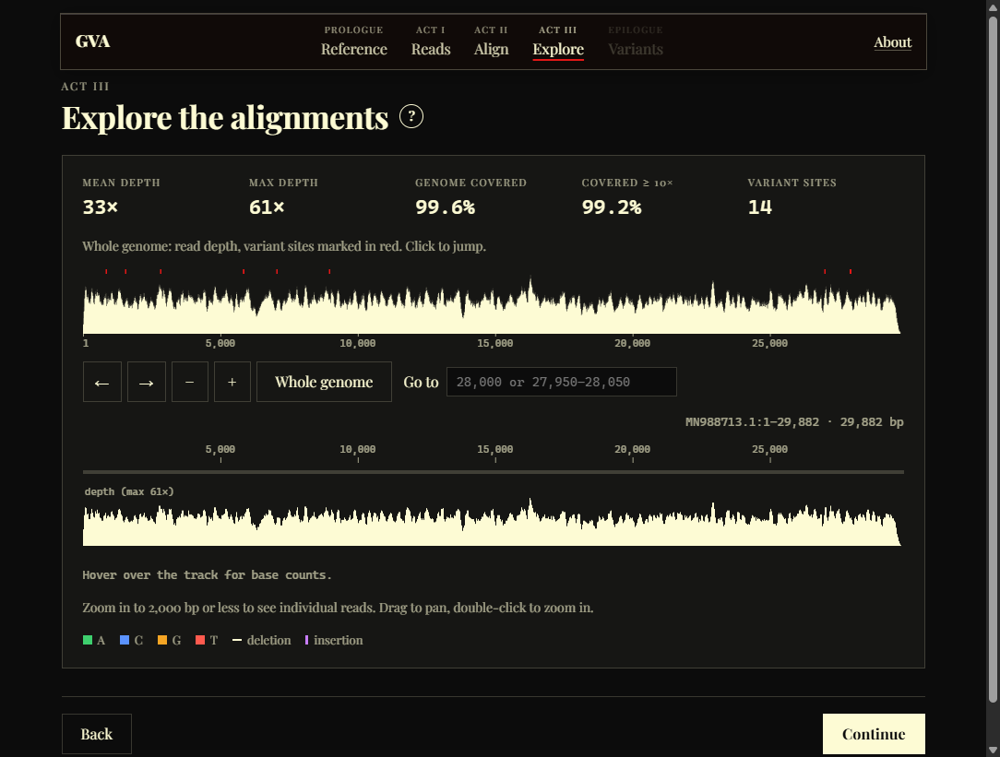
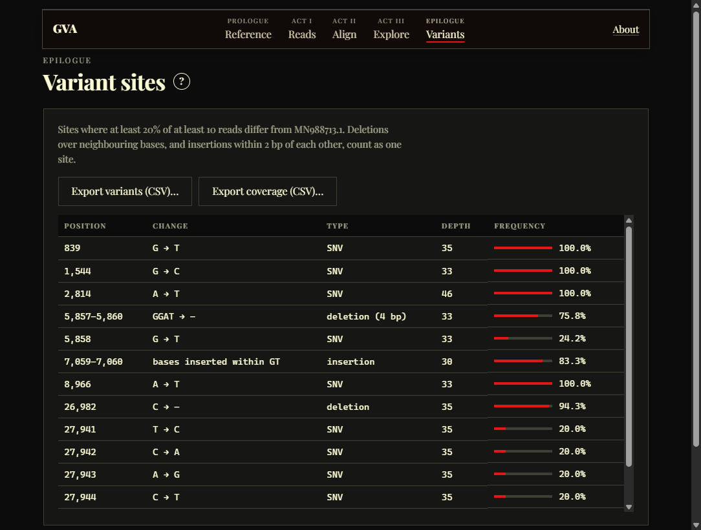

<div align="center">


# coronavirus-genome-variant

[](https://github.com/RyanDBurke/coronavirus-genome-variant/actions/workflows/ci.yml)
[](LICENSE)

A Windows desktop app and command-line tool that aligns sequencing reads to the SARS-CoV-2 genome and shows where they differ from it. Under the hood: an FM-index seed search (Burrows-Wheeler transform and suffix array) followed by dynamic-programming alignment.

</div>

<p align="center">
  
</p>

## Download

Get `GenomeVariantAligner-Setup-<version>.exe` from [Releases](https://github.com/RyanDBurke/coronavirus-genome-variant/releases). It runs on Windows 10 and 11, installs without admin rights, and works offline with the reference genome and example reads built in.

## Using the app

The app walks you through five pages: pick a reference (SARS-CoV-2 is built in), pick a read set (1K, 10K or 1M simulated reads, or your own FASTA/FASTQ, optionally gzipped), press **Align reads**, then explore the result. You get:

- read counts and a SAM file you can save;
- read depth across the genome, with variant sites marked; when you zoom in, the part you're viewing stays highlighted and the rest is dimmed;
- a zoomable view of the reference, depth and individual reads that you can drag, or slide along with the arrow buttons;
- a table of variant sites: positions where at least 20% of at least 10 reads differ from the reference;
- CSV exports of the variants and per-base coverage.

<p align="center">
  
</p>

## How it works

1. **Index.** Build a suffix array of the genome, derive the Burrows-Wheeler transform, and add rank tables to form an FM-index (`src/fmIndex.c`).
2. **Seed.** Split each read into five seeds and find exact matches with FM-index backward search. A seed containing a variant finds nothing; the others still place the read.
3. **Extend.** At each candidate position, run a fitting alignment against the reference plus 5 bp of padding (`src/align.c`) to get the start position and CIGAR.
4. **Report.** Write the best alignments as SAM: one primary record per read, equally good alternatives as secondary, unmapped reads flagged.

## For developers

### Build

**Debian / Ubuntu**

```bash
./dep.sh    # gcc, make, zlib, samtools
make        # builds ./run
```

**Windows (native).** Install [MSYS2](https://www.msys2.org/) (`winget install MSYS2.MSYS2`), open the **MSYS2 UCRT64** terminal in the repo, and run:

```bash
pacman -S --needed make mingw-w64-ucrt-x86_64-gcc mingw-w64-ucrt-x86_64-zlib mingw-w64-ucrt-x86_64-python
make        # builds run.exe, which runs anywhere on Windows 10/11
```

**Windows (WSL).** Run `wsl --install` once, then `.\dep.ps1` and `wsl make` from the repo in PowerShell. Prefix the commands below with `wsl`.

### Run

| Command | Reads |
|---|---|
| `./run` | Small demo (`default/`); also writes the FM-index to `fm-output/` |
| `./run covid 1K` / `10K` / `1M` | 1,000 / 10,000 / 1,000,000 simulated reads (1M takes about 2½ minutes) |
| `./run -r REF.fa -q READS.fa -o OUT.sam` | Your own files (`.gz` works) |

On native Windows use `.\run.exe`. Output defaults to `mappings/mapping.sam`. Options: `-o -` writes SAM to stdout, `--quiet` hides progress, `--progress-json` is described below, and `--help` lists everything.

#### For programs calling the aligner

With `--progress-json`, stderr carries one JSON object per line:

```json
{"event":"index","length":29882}
{"event":"progress","percent":41}
{"event":"done","reads":1000,"mapped":1000,"unmapped":0,"seconds":0.12}
```

Errors arrive as `{"event":"error","code":"input","message":"..."}`, and the exit code says what went wrong:

| Exit code | `code` | Meaning |
|---|---|---|
| 0 | | Success |
| 1 | `internal` | Internal error (a bug) |
| 2 | `usage` | Invalid command line |
| 3 | `input` | Reference or reads file missing, unreadable, empty or corrupt |
| 4 | `output` | SAM or FM-index file can't be written |
| 5 | `memory` | Out of memory |

Unaligned reads are flagged unmapped (`FLAG 4`); equally good extra alignments are flagged secondary (`FLAG 256`).

### Test

`make test` (in MSYS2 UCRT64 on Windows) runs unit tests, a known-answer test of 52 reads with planted SNPs and indels, a check of 1,000 simulated reads, and command-line checks. On Linux the C tests run under AddressSanitizer and UndefinedBehaviorSanitizer. CI runs it on Linux and Windows.

### Desktop app

Needs Node.js 22 and a built `run.exe` in the repo root.

```powershell
cd app
npm install
npm start       # run from source
npm test        # unit, integration and click-through tests
npm run dist    # build the installer into app/dist/
```

Pushing a `v*` tag builds a GitHub Release. Security notes are in [app/SECURITY.md](app/SECURITY.md).

### Viewing results in IGV

Convert the SAM to an indexed BAM with samtools (`samtools sort -o mapping.bam mapping.sam && samtools index mapping.bam`), then in [IGV](https://software.broadinstitute.org/software/igv/download) load `2019-nCoV.fa` as the genome and open `mapping.bam`.

### Project layout

```
├── 2019-nCoV.fa      # SARS-CoV-2 reference genome (MN988713.1)
├── reads/            # simulated reads: 1K, 10K, 1M (gzipped FASTA)
├── src/, include/    # the aligner (C); include/vendor/kseq.h is the FASTA parser
├── tests/            # unit, known-answer and CLI tests
├── win/              # Windows manifest and version info for run.exe
├── app/              # desktop app (Electron + TypeScript)
├── default/          # small demo input
└── mappings/, fm-output/   # demo output
```

## References

- [SARS-CoV-2 isolate USA-IL1/2020 (MN988713.1)](https://www.ncbi.nlm.nih.gov/nuccore/MN988713.1)
- [FASTA parser (readfq)](https://github.com/lh3/readfq)

## Future goals

- Soft-clipping for reads that cross a large deletion
- Reverse-strand reads (`FLAG 16`)
- Banded alignment to speed up the extension step
- A compressed suffix array ([paper](https://www.cs.cmu.edu/~dga/csa.pdf)) for much larger genomes

## License

[MIT](LICENSE). `include/vendor/kseq.h` is by Heng Li (© Genome Research Ltd), also MIT.
