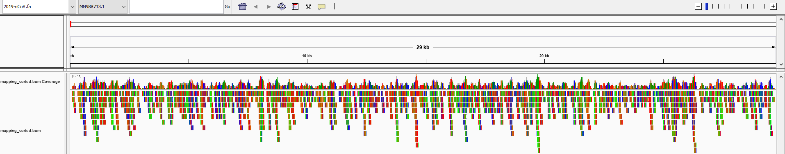

<div align="center">

# :seedling: coronavirus-genome-variant

[](https://github.com/RyanDBurke/coronavirus-genome-variant/actions/workflows/ci.yml)
[](LICENSE)

A basic seed-search alignment tool to compare read-variants to the nCov-19 virus genome using Burrows-Wheeler transform, suffix arrays, the FM-Index, and core dynamic programming principles.



</div>

## Contents

- [Quick start](#quick-start)
- [Requirements](#requirements)
- [Setup](#setup)
- [Running](#running)
- [Testing](#testing)
- [Viewing results in IGV](#viewing-results-in-igv)
- [How it works](#how-it-works)
- [Troubleshooting](#troubleshooting)
- [Project layout](#project-layout)
- [References](#references)
- [Future goals](#future-goals)
- [License](#license)

## Quick start

On Debian/Ubuntu (or inside WSL):

```bash
git clone https://github.com/RyanDBurke/coronavirus-genome-variant.git
cd coronavirus-genome-variant
./dep.sh       # install dependencies
make           # build ./run
./run          # small demo run
```

On Windows, see [Setup → Option B: Windows PowerShell](#option-b-windows-powershell).

## Requirements

- Debian or Ubuntu. On Windows, use [WSL](https://learn.microsoft.com/windows/wsl/install).
- `dep.sh` installs everything needed:
  - `gcc` and `make`: to build
  - `zlib1g-dev`: to read the gzipped read files
  - `samtools`: only needed to prepare results for IGV

## Setup

### 1. Clone

```bash
git clone https://github.com/RyanDBurke/coronavirus-genome-variant.git
cd coronavirus-genome-variant
```

### 2. Install dependencies and build

Pick the option for your system:

- [Option A: Debian or Ubuntu](#option-a-debian-or-ubuntu)
- [Option B: Windows PowerShell](#option-b-windows-powershell)

#### Option A: Debian or Ubuntu

```bash
./dep.sh       # install dependencies (uses sudo apt-get, so it asks for your password)
make           # build ./run
```

#### Option B: Windows PowerShell

Everything runs inside WSL. From the repo folder in PowerShell:

```powershell
wsl --install            # one-time; restart if prompted
.\dep.ps1                # install dependencies inside WSL (asks for your Ubuntu sudo password)
wsl make                 # build ./run
```

## Running

Run **one** of these:

| Debian / Ubuntu | Windows PowerShell | Input reads | Notes |
|---|---|---|---|
| `./run` | `wsl ./run` | `default/reads-small.fa` | Small demo against `default/ref-small.fa`. Also writes the FM-Index to `fm-output/FMindex.txt`. |
| `./run covid 1K` | `wsl ./run covid 1K` | `reads/reads_1K.fa.gz` | 1,000 reads against `2019-nCoV.fa` |
| `./run covid 10K` | `wsl ./run covid 10K` | `reads/reads_10K.fa.gz` | 10,000 reads |
| `./run covid 1M` | `wsl ./run covid 1M` | `reads/reads_1M.fa.gz` | 1,000,000 reads. Takes about 2½ minutes. |
| `./run -r REF.fa -q READS.fa -o OUT.sam` | `wsl ./run -r REF.fa -q READS.fa -o OUT.sam` | any FASTA file (`.gz` works too) | Your own reference and reads. |

Without `-o`, alignments go to `mappings/mapping.sam`, overwriting the previous result. The FM-Index file is only written for references of 50 bp or less, which is why only the demo produces it.

Other options, which also work with the presets (for example `./run covid 1K -o 1k.sam`):

| Option | Effect |
|---|---|
| `-o -` | Write SAM to stdout, e.g. `./run -r REF.fa -q READS.fa -o - \| samtools sort -o out.bam` |
| `--quiet` | No progress bar or status messages |
| `-h`, `--help` | List all options |

Status messages and the progress bar go to stderr, so they never mix with SAM output.

Reads that don't align still get a SAM record, flagged unmapped (`FLAG 4`). When a read aligns equally well in several places, the first is the primary record and the others are flagged secondary (`FLAG 256`).

## Testing

Debian / Ubuntu:

```bash
make test
```

Windows PowerShell:

```powershell
wsl make test
```

This needs `python3`, which Ubuntu includes. It runs three checks and fails on the first problem:

1. **Unit tests** (`tests/test_units.c`) for CIGAR building, FM-Index backward search (checked against a brute-force scan), and scoring.
2. **Known-answer test**: aligns `tests/fixtures/reads.fa`, 52 reads cut from the genome at known positions with injected SNPs and indels. Each must map at exactly its true position with the expected CIGAR.
3. **Simulated reads**: aligns `reads/reads_1K.fa.gz` and checks every record replays cleanly against the reference. At least 99% of reads must map.

Checks 1 and 2 run under AddressSanitizer, UndefinedBehaviorSanitizer and LeakSanitizer, so memory errors and leaks fail the build. Everything compiles with `-Wall -Wextra -Werror`. CI runs `make test` on every push to `master` and every pull request.

Test output goes to `tests/out/`. Other targets:

| Target | What it does |
|---|---|
| `make asan` | Builds `build/run-asan`, the aligner with sanitizers, for debugging |
| `make fixture` | Regenerates the known-answer fixture after changing `tests/make_fixture.py` |
| `make clean` | Removes `./run`, `build/` and `tests/out/` |

## Viewing results in IGV

1. Install [IGV](https://software.broadinstitute.org/software/igv/download).
2. Convert the mapping to an indexed BAM file.

   Debian / Ubuntu:

   ```bash
   cd mappings/
   samtools view -b -o mapping.bam mapping.sam
   samtools sort -o mapping_sorted.bam mapping.bam
   samtools index mapping_sorted.bam
   ```

   Windows PowerShell:

   ```powershell
   cd mappings
   wsl samtools view -b -o mapping.bam mapping.sam
   wsl samtools sort -o mapping_sorted.bam mapping.bam
   wsl samtools index mapping_sorted.bam
   ```

3. In IGV, load the genome: **Genomes → Load Genome From File**, then select `2019-nCoV.fa`.
4. Load the alignment: **File → Load From File**, then select `mappings/mapping_sorted.bam`. Keep `mapping_sorted.bam.bai` (created by `samtools index`) in the same folder.
5. Optional: see IGV's guide to [navigating alignment data](https://software.broadinstitute.org/software/igv/AlignmentData).

## How it works

1. **Index the genome.** Build the suffix array of the genome (plus a `$` end marker), derive the Burrows-Wheeler transform from it, and add rank tables (occurrence counts checkpointed every 64 rows). Together these form the FM-Index (`src/fmIndex.c`).
2. **Seed.** Split each read into five equal seeds (20 bp for 100 bp reads) and find every exact occurrence of each seed with FM-Index backward search. A seed containing a variant simply finds nothing; the other seeds still place the read.
3. **Extend.** For each candidate position, cut the reference with 5 bp of padding on both sides and run a fitting alignment, a dynamic-programming alignment where the whole read must align but reference bases outside it are free (`src/align.c`). The traceback gives the start position and CIGAR string.
4. **Report.** Keep the best-scoring alignments across all seeds and write SAM: one primary record per read, equally good alternatives as secondary, and unmapped reads flagged.
5. **Visualize.** Load the SAM into Integrative Genomics Viewer (IGV) to see coverage (the image at the top).

## Troubleshooting

- **`./dep.sh: No such file or directory`, or errors mentioning `bash\r`.** The script was checked out with Windows line endings. Pull the latest version (which includes `.gitattributes`), delete `dep.sh` and `Makefile`, then run `git checkout -- dep.sh Makefile`.
- **`wsl .\run` fails with `.run: command not found`.** Bash reads `\` as an escape character. Use `wsl ./run`.
- **PowerShell refuses to run `dep.ps1`.** Run `Set-ExecutionPolicy -Scope CurrentUser RemoteSigned` once, or use `wsl ./dep.sh` instead.

## Project layout

```
coronavirus-genome-variant
├── README.md
├── LICENSE               # MIT
├── 2019-nCoV.fa          # nCov-19 genome sequence
├── dep.sh                # installs dependencies (Debian/Ubuntu)
├── dep.ps1               # runs dep.sh through WSL from PowerShell
├── Makefile              # builds ./run; `make test` runs the tests
├── .github/workflows
│   └── ci.yml            # CI: runs make test on pushes and pull requests
├── include               # headers: structures and function declarations
│   ├── align.h           # read alignment
│   ├── fmIndex.h         # FM-Index construction and backward search
│   ├── misc.h            # command-line handling, progress bar
│   ├── std.h             # shared structures and constants
│   └── vendor
│       └── kseq.h        # FASTA parser (third-party, MIT)
├── src
│   ├── main.c            # entry point: builds the FM-Index, then runs the aligner
│   ├── align.c
│   ├── fmIndex.c
│   └── misc.c
├── tests
│   ├── test_units.c      # unit tests (run under ASan/UBSan)
│   ├── make_fixture.py   # generates the known-answer fixture
│   ├── validate_sam.py   # checks SAM output against the reference
│   └── fixtures
│       ├── reads.fa      # 52 reads with known positions and variants
│       └── truth.tsv     # true position, SNP count and indel type per read
├── default               # small demo input
│   ├── reads-small.fa
│   └── ref-small.fa
├── reads                 # gzipped FASTA reads (1K, 10K, 1M)
│   ├── reads_1K.fa.gz
│   ├── reads_10K.fa.gz
│   └── reads_1M.fa.gz
├── fm-output
│   └── FMindex.txt       # FM-Index output from the demo run
├── mappings              # alignment output (.sam)
│   └── mapping.sam       # output of the latest run
└── png
    └── IGV-10K.png       # IGV screenshot used above
```

`make` also creates `build/` (object files and sanitizer builds) and `./run`. Both are git-ignored.

## References

- [FASTA parser (readfq)](https://github.com/lh3/readfq)
- [nCov-19 genome (NC_045512.2)](https://www.ncbi.nlm.nih.gov/nuccore/NC_045512.2?report=fasta)

## Future goals

- **Soft-clipping.** Reads that cross a large deletion in the sample currently align end to end with a cluster of mismatches at one end; clipping that end (`S` in the CIGAR) would be more accurate. About 0.01% of the 1M simulated reads are affected.
- **Reverse-strand reads.** Reads are aligned as given; reads from the opposite strand would also need their reverse complement tried, with SAM `FLAG 16`.
- **Faster extension.** Most run time is now the dynamic-programming step; a banded alignment would cut it.
- **Compressed suffix array** ([paper](https://www.cs.cmu.edu/~dga/csa.pdf)), to keep memory low for genomes much larger than this one.

## License

[MIT](LICENSE). `include/vendor/kseq.h` is third-party code (Heng Li, © Genome Research Ltd), also MIT-licensed; its license is in the file header.
